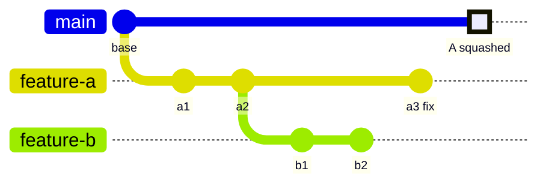

This week I had a few chains of stacked pull requests open on a side project. I squash-merged the first PR in one chain, opened the second, and GitHub said it had conflicts. In files that PR never changed.

Then the same thing happened to the third PR, and the fourth. This post is what was going on, how I got out of it, and what I do differently now.

## The setup

A stack is a chain of branches where each one starts from the one before it, so each PR stays small and reviewable:

- `feature-a` branches from `main`. PR A targets `main`.
- `feature-b` branches from `feature-a`. PR B targets `feature-a`.
- `feature-c` branches from `feature-b`. PR C targets `feature-b`.

B's diff on GitHub shows only B's changes, because its base is `feature-a`. That part works well.

The repo was set to squash merges, which I like for normal PRs: one PR, one commit on `main`, a clean history.

## What went wrong

Here's a smaller version of what happened. A had two commits when I started B on top of it. Then A got a review fix, `a3`, which B never picked up. Then I squash-merged A.



After the squash, `main` has one new commit, `A`, with a new SHA. `feature-b` still has `a1` and `a2`, the original commits. Git doesn't know that `A` contains the same work. To Git they're unrelated commits that happen to touch the same files.

You can see it straight away:

```bash
git fetch origin
git log --oneline origin/main..feature-b
# 7c1e9d4 b2
# 52b0f8a b1
# 9a4d2e1 a2
# 3f6b7c0 a1
```

B's PR now targets `main` (GitHub retargets it when `feature-a` is deleted), and it shows four commits instead of two. `a1` and `a2` are back, and they no longer match what's on `main`.

### Why the conflicts land in files B never touched

When Git merges `main` into `feature-b`, it compares both sides against their merge base, which is `base`. Both sides changed A's files:

- `main` changed them to A's final version, `a3` included.
- `feature-b` changed them to A's old version, without `a3`.

Where `a3` touched the same lines as `a1` or `a2`, those are two different edits to the same lines, so Git stops and asks. If A had never changed after B branched, a merge would often go through cleanly. In a real stack, the bottom PR almost always changes during review.

`git rebase main` is worse. It replays `a1`, then `a2`, one at a time, on top of a `main` that already has the final version. Each replayed commit can conflict on its own, so you resolve A's history again, commit by commit.

And the chain makes it worse still. C carries `a1`, `a2`, `b1` and `b2`. Squash B, and C has two sets of stale commits.

## How I recovered

Two ways, depending on whether you're OK rewriting the branch.

### Option 1: merge main into B (no force push)

This is the safer one. Nothing gets rewritten, and the PR keeps its review comments and commit history.

```bash
git switch feature-b
git fetch origin
git merge origin/main
```

For each conflict in a file only A touched, take `main`'s side. That's A's final, reviewed version:

```bash
git checkout --theirs path/to/file_from_a.py
git add path/to/file_from_a.py
```

For files B actually changed, resolve by hand as usual. Then run the tests and push:

```bash
git commit
git push
```

After that, B's PR diff on GitHub shows only B's changes again. When B is squash-merged, the extra merge commit disappears into the squash anyway.

### Option 2: rebase only B's own commits onto main

If it's your own branch and you're fine with a force push, `git rebase --onto` drops A's old commits and keeps only B's:

```bash
git switch feature-b
git fetch origin
# the last commit of A that B contains, here a2
git log --oneline origin/main..feature-b
git rebase --onto origin/main 9a4d2e1 feature-b
git push --force-with-lease
```

This reads as: take the commits after `9a4d2e1` up to `feature-b`, and replay them on `origin/main`. Only `b1` and `b2` move. The SHA you pass has to be the old tip of A as B saw it (`a2`), not A's final tip (`a3`). If you're not sure, it's the last A commit in B's commit list on the PR.

Use `--force-with-lease`, not `--force`, so you don't overwrite something someone else pushed.

Then do the same for C, with B's old tip as the cut point.

## How to avoid it

Any one of these works:

- **Use "Create a merge commit" for stacked PRs.** The merge keeps A's original commits on `main`, so the A commits inside B are already there and B merges cleanly. You can keep squash as the default for everything else; the merge button lets you pick per PR.
- **Rebase and retarget each child right after each squash.** Squash A, then immediately `rebase --onto` B onto `main`, retarget B's PR to `main`, push. Then move on to C. It works, but it's a manual step every time, and it's easy to skip.
- **Use a tool built for stacks.** Graphite, ghstack and spr all track the stack for you and do the restacking after a merge. They each assume a slightly different workflow, so pick the one that fits how your team merges.

What I've stopped doing is squash-merging the bottom of a stack and then opening the rest one by one.

## The trap: a clean merge that still breaks

This one surprised me more than the conflicts.

One PR in a stack was a lint cleanup. Among other things, the linter removed an `import json` that was unused at that point. Another PR higher up added new code in the same file that called `json.loads`.

Git merged the two without a single conflict. The import removal was at the top of the file and the new code was further down, so the hunks didn't overlap. The result:

```python
# the import json line is gone, removed by the lint PR

def parse_output(raw: str) -> dict:
    return json.loads(raw)  # added by the stacked PR
```

```text
NameError: name 'json' is not defined
```

Each change was fine on its own branch. The combination wasn't. The linter caught it as an undefined name, and the tests caught the `NameError`, but only because they ran on the merged result.

A clean merge only means the text didn't overlap. It says nothing about whether the code still works. Run lint and tests on the merged branch, not just on each PR before the merge.

## Lessons

- A squash merge makes a new commit. Any branch built on the old commits will disagree with it.
- For a stack, use merge commits, or restack every child right after each squash.
- When a PR suddenly conflicts in files it never touched, check `git log origin/main..<branch>` first. Stale parent commits are the usual cause.
- `git merge origin/main` is the safe fix. `git rebase --onto` is the clean one, if you're allowed to force-push.
- After any merge, run lint and tests on the result. A conflict-free merge can still break the build.

Stacks are worth it for keeping PRs small. They just need the merge strategy to match.

Thank you for the read.
