# Site revamp: replacing Hugo + PaperMod

Status: done. The design and prototype went in with #2 and the build with #3, and Hugo/PaperMod are now removed from the repo. The build lives in `site/` (see README). Date: 2026-10-19.

I like how the site looks today. What I don't like is that I don't own any of it. The look comes from a PaperMod submodule I've had to fork piece by piece, and the build depends on Hugo behaviour I can't see. So the plan is to **rewrite the build and templates and keep the same look**. It's not a redesign.

## 1. What Hugo + PaperMod do for me today

| Feature | How it works now | Notes |
|---|---|---|
| Posts | `content/posts/*.md` → `/posts/<slug>/` | 9 posts. Covers, ToC (`ShowToc`), tags and categories |
| Dailies | `content/daily/*.md` → `/daily/<date>/`, index at `/dailies/` | 2 entries, custom `layouts/daily/single.html` and `_default/dailies.html` |
| Single pages | `about` (custom layout), `resume`, `now`, `archives` | `now` uses a `` shortcode (git date) |
| Shortcodes | `figure` (8 uses), `mermaid` (4), `lastmod` (1) | `figure` is Hugo's built-in |
| Taxonomies | `tags`, `categories`, `series` → `/tags/<t>/`, `/categories/<c>/`, `/series/` | 9 tags (one is `ui/ux`, which becomes a nested path `/tags/ui/ux/`), 6 categories |
| Pagination aliases | `/page/1/`, `/posts/page/1/`, `/tags/*/page/1/`, … | 19 meta-refresh redirects. Nothing links to them, but they're indexed |
| Home | `home_info.html` intro plus every post as a card | Order follows Hugo's default: posts with a `weight` first, then newest first. That's why 2023–25 posts show up last |
| RSS | `/index.xml`, plus one per section and per term | Custom `layouts/_default/rss.xml` |
| Sitemap | `/sitemap.xml` | Hugo built-in |
| Search | `index.json` (Fuse.js index) is generated, `layouts/_default/search.html` exists | **No `/search/` page is actually built** (there's no `content/search.md`). The JSON is dead weight today |
| Dark/light | `body.dark` by default, toggle stored in `localStorage["pref-theme"]` | `defaultTheme: dark` |
| Highlighting | highlight.js 10.2 (100 KB) auto-detects every `<pre><code>` in the browser | No fenced code in my posts has a language set |
| Mermaid | Mermaid 10.6 from a CDN (~3 MB) **on every page** via `extend_head.html` | Only 1 post uses it |
| Font Awesome | The full 6.4 CSS on every page | Only the archives page uses `<i class="fa-…">` |
| Meta | OpenGraph, Twitter cards and JSON-LD; overridden `templates/opengraph.html` and `twitter_cards.html` | Only emitted when built in production mode |
| Favicons | Emitted twice: by `head.html` and again, hard-coded, in `baseof.html` | Nothing per section, so `/eyrie` can't have its own |
| Analytics | Plausible script in `extend_head.html` | Pages can opt out with `excludeAnalytics` |
| Deploy | `hugo` branch → GH Actions (`hugo-version: latest`, `actions/checkout@v2`) → `peaceiris/actions-gh-pages` → `gh-pages` on `abrahamalen/alen-abraham.github.io` | `static/CNAME` = `alenabraham.me` |

Other things I found while auditing:
- `config.yml` nests `ShowReadingTime`, `ShowShareButtons`, `ShowToc`, `ShowPostNavLinks` and others **under `cover:`**, so none of them take effect. The current look depends on them being off, so the rewrite keeps them off.
- About 15 theme files are copied into `layouts/` and `assets/css/`, and they've drifted. `head.html` alone differs from the pinned theme by about 360 lines. I already maintain a fork without the benefits of owning one.
- My `feature/update-resume` branch has no commits left that aren't in `hugo` (it was merged in #1 and #36). The only WIP is uncommitted edits inside the submodule, to `templates/opengraph.html` and `twitter_cards.html`. The repo root overrides both files, so **those edits don't do anything**. Once Hugo is gone they won't matter. I need to check whether there's anything in them I want to carry over.

## 2. Goals / non-goals

**Goals**
- Full ownership: templates, CSS and the build script all live in this repo, and I can read every line.
- The site looks the same, pixel-close, in light and dark (see the screenshots in section 6).
- Content stays as Markdown with the same front matter, so posts don't change.
- **Every existing URL keeps working**, or gets a redirect.
- RSS and the sitemap are kept. The deploy goes to the same `gh-pages` target and CNAME.
- `/eyrie` can have its **own `<head>` and favicon set**, separate from the site's "ae" icons.
- Small fixes that don't change the look: Resume and Now in the nav, Mermaid and highlighting only where they're used, and favicons emitted once.

**Non-goals**
- A visual redesign.
- Rewriting post content.
- Building the `/eyrie` page itself. It comes later and needs only the hooks above.
- Client-side frameworks, and comments or a newsletter.

## 3. Approaches

### (a) My own build script in Python (recommended)
Python is my main language. The script reads `content/**/*.md`, renders it with my own Jinja templates, and writes `public/`.
- **Deps, pinned:** `markdown-it-py==3.0.0`, `linkify-it-py==2.0.3`, `Jinja2==3.1.4`, `PyYAML==6.0.2`, plus `Pygments==2.18.0` in the code PR for build-time highlighting, which drops the 100 KB of highlight.js. That's it, run with `uv` from a pinned `requirements.txt`.
- **Size:** about 400–600 lines. The prototype in `prototype/build.py` is about 160 lines and already does posts, single pages, shortcodes, ToC, heading anchors (Hugo-compatible ids), covers and tags.
- RSS, sitemap, the alias redirects and `index.json` are just more Jinja templates.
- **Pros:** total control and nothing hidden. A tiny dependency surface that rarely changes. No theme or framework upgrades to chase. It's the language I already debug in.
- **Cons:** I own the edge cases (smart quotes, slug rules, feed correctness). There's no dev server with live reload; `python -m http.server` plus a file watcher (`watchfiles`) covers it.

### (b) Eleventy 3.x
JS/Node, with Nunjucks or Liquid templates and the same Markdown files.
- **Pros:** made for this kind of site. Official plugins for RSS, highlighting and pagination. It lets me keep my own templates.
- **Cons:** I trade the Hugo dependency for an npm tree of a few hundred packages and Eleventy's own conventions (data cascade, collections), which is the same "magic" problem on a smaller scale. Node isn't my main stack.

### (c) Astro 5
Component-based (`.astro`), content collections, Vite underneath.
- **Pros:** great DX and typed content, and a good fit if `/eyrie` ever needs interactive islands.
- **Cons:** the heaviest option: Vite, a large dependency tree, and frequent major versions. It's opinionated about structure. It's overkill for about 15 pages of Markdown and the furthest from "I own every line".

**Decision: (a).** "Full control" is the main goal, and a small Python script with 4–5 pinned libraries is the only option where I can read and own the whole pipeline. Eleventy is the fallback if the script grows past roughly 800 lines or the edge cases start costing more than they're worth.

## 4. Target layout (code PR)

```
build.py               # the generator (from prototype/build.py)
requirements.txt       # pinned
templates/             # base, home, single, list, archives, dailies, about, rss.xml, sitemap.xml, alias.html
  partials/            # head, header, footer, social_icons, theme_toggle, favicons
static/                # unchanged (images, favicons, CNAME), plus css/ and js/ that I own
content/               # unchanged
redirects.yaml         # old → new paths I want to keep alive
tests/test_urls.py     # URL-parity check against a frozen list of today's URLs
```

- **CSS:** start from the CSS PaperMod compiles today (MIT, attribution kept), then split it into readable files (`base`, `header`, `post`, `list`, `resume`, `code`) and delete the rules I don't use. The prototype ships the compiled file verbatim, which is how it matches the current look.
- **URL parity:** I'll freeze today's URL set (`hugo` build → `find public -name index.html` plus feeds) into `tests/urls.txt`. CI fails if the new build is missing any of them. The `*/page/1/` aliases become generated meta-refresh pages, the same as Hugo makes now.
- **Feeds:** keep `/index.xml` and the per-section and per-term `index.xml` files (all of them, so no subscriber breaks), plus `/sitemap.xml`.
- **Search:** there's no search page today, so I'll stop emitting `index.json` (or keep it if I want search later; see open questions).

## 5. `/eyrie` hooks

- The favicon `<link>`s come from one `partials/favicons.html` that reads a `favicons:` prefix from front matter and falls back to `/`. The prototype already does this.
- The `eyrie` section can name its own base template (`templates/eyrie/base.html`) with its own `<title>`, description, OG image, theme colour and favicon set under `static/eyrie/`, with or without the site header and footer.
- It stays out of the nav until the page ships.

## 6. Prototype

`prototype/` builds the home page, every post, `/resume/` and `/now/` from the real `content/` with my own templates:

_The prototype has since become `site/`, so `make build` / `make serve` replaces these steps (see README)._

The only visible differences from the current site are in the nav (adding **Now** and **Resume**) and the footer (dropping "Powered by Hugo & PaperMod"). Below the visible look: Mermaid only loads on the diagram post, highlight.js only on pages that have code, and favicons are emitted once.

Current is on the left, the prototype on the right (1280×900; mobile is 390×844, rendered in an iframe because headless Chrome won't open a window narrower than about 500px).

| | Current (Hugo + PaperMod) | Prototype (own build) |
|---|---|---|
| Home, dark | 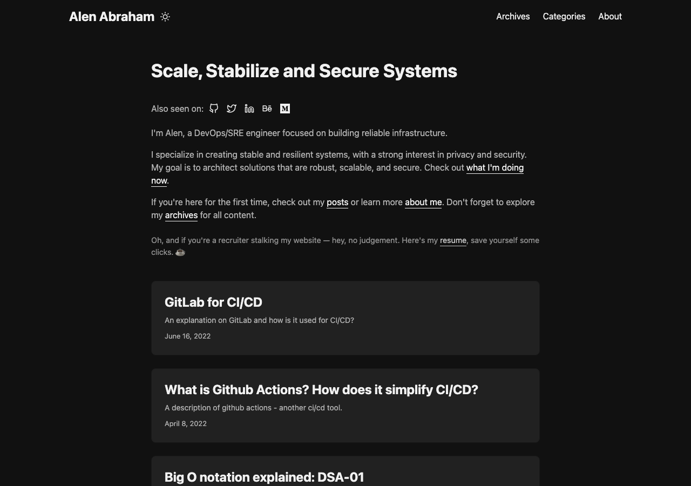 | 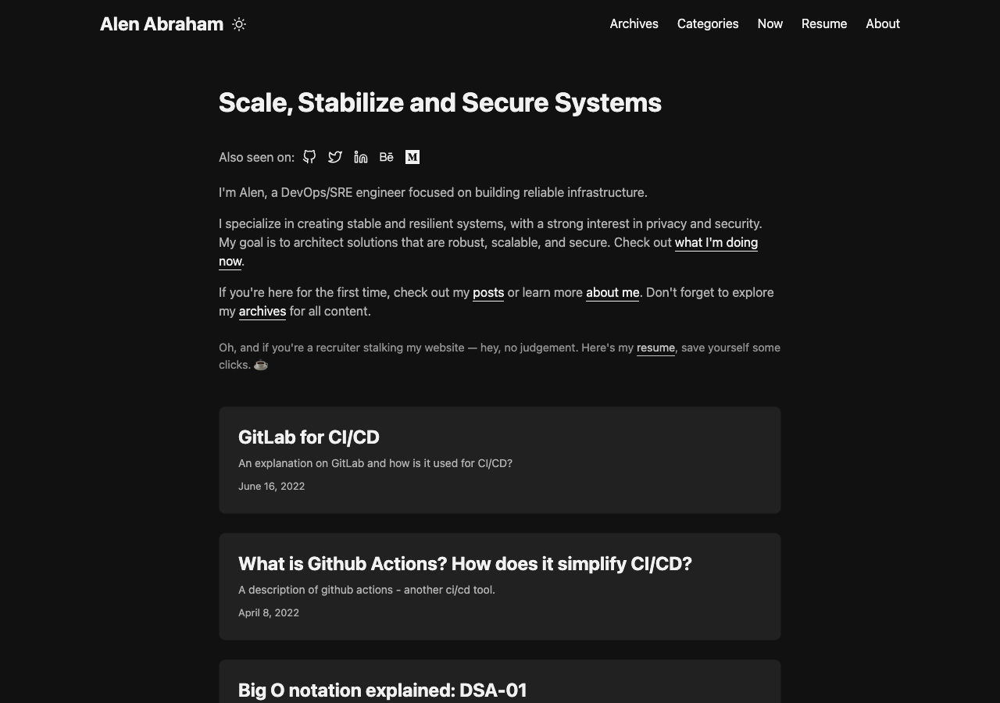 |
| Home, light | 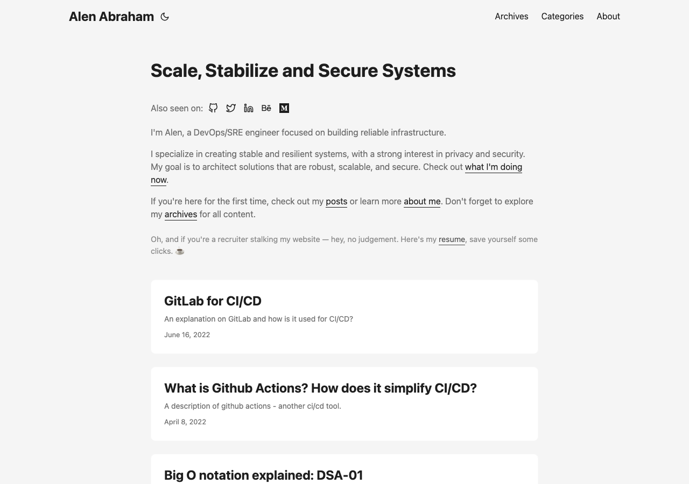 | 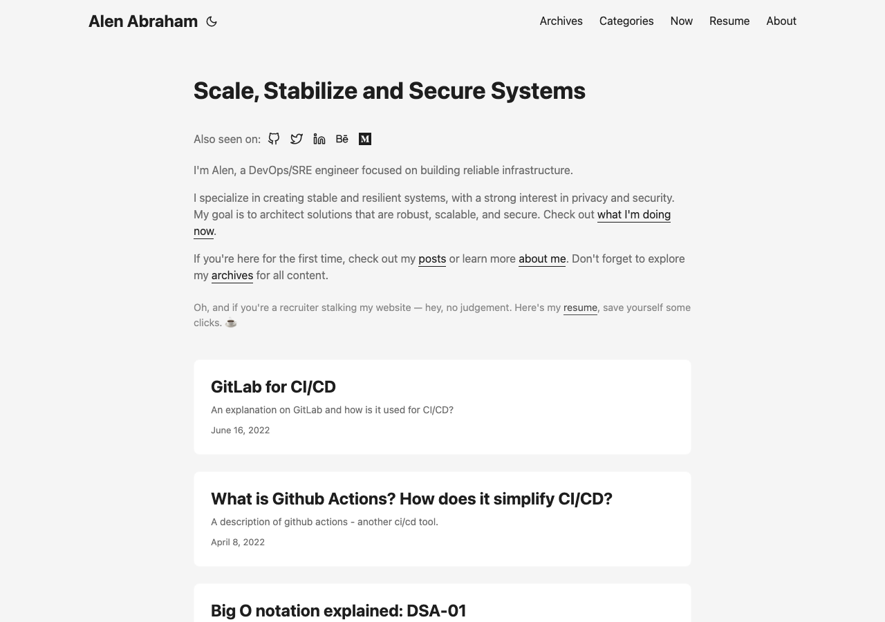 |
| Post, dark | 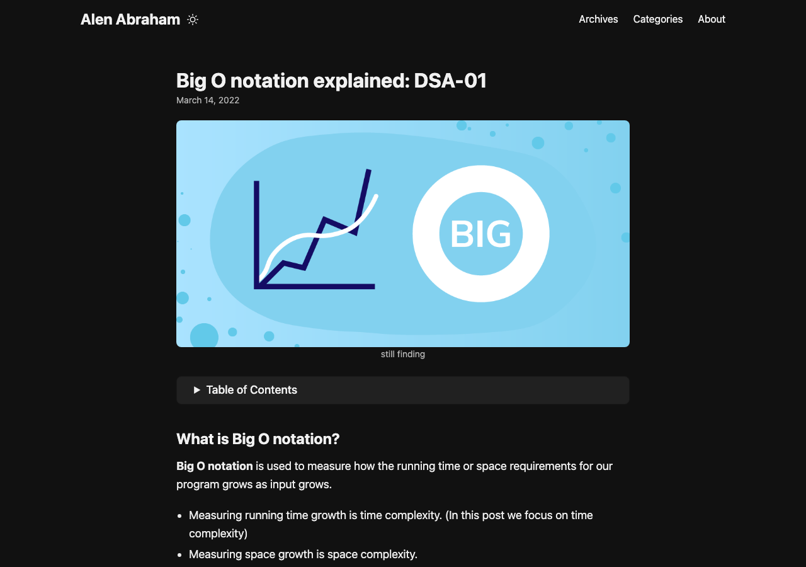 | 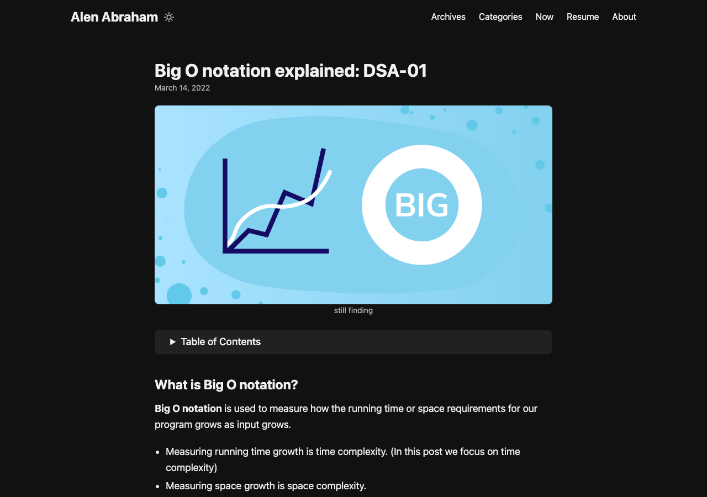 |
| Post, light |  | 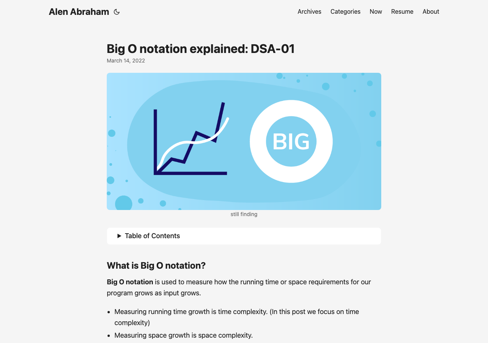 |
| Resume, dark | 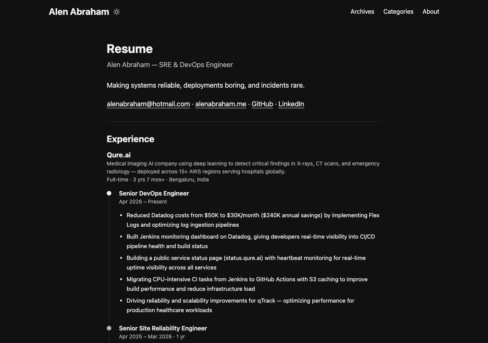 | 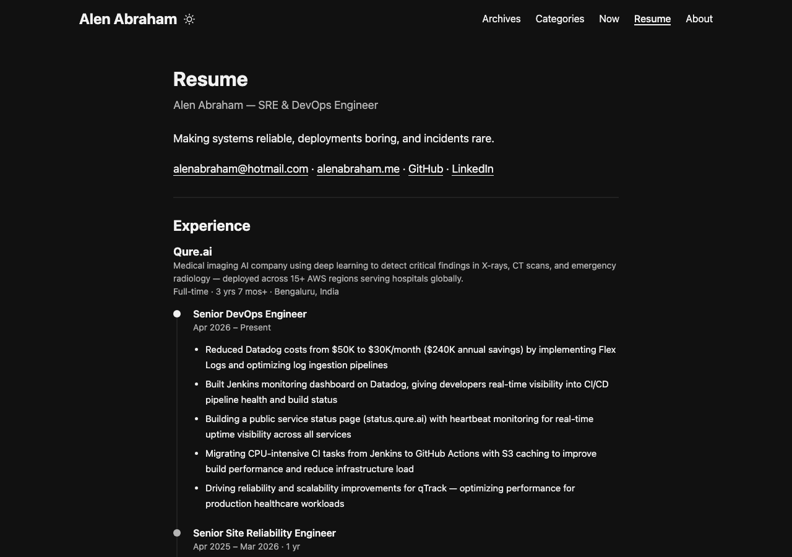 |
| Resume, light | 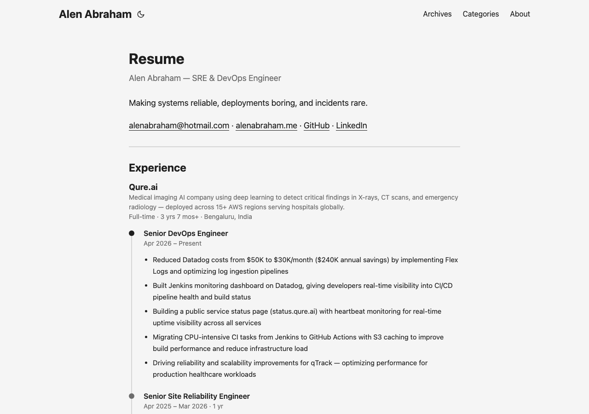 |  |
| Home, mobile | 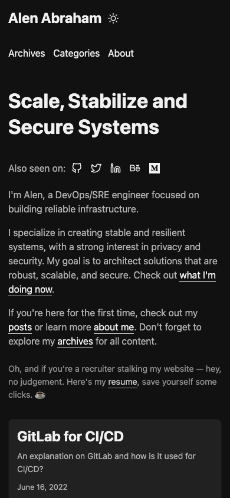 | 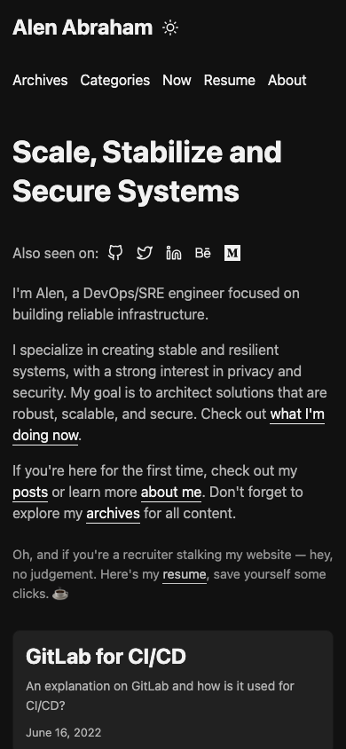 |

## 7. Migration PR (next, after this one is merged)

1. Promote `prototype/` to the repo root (`build.py`, `templates/`, CSS split into owned files).
2. Add the remaining templates: list and taxonomy pages, archives, dailies, about, RSS, sitemap, alias redirects and 404.
3. Freeze the URL list from the last Hugo build and add the parity test.
4. CI: replace `peaceiris/actions-hugo` with `astral-sh/setup-uv` and run `uv run build.py`. Keep `peaceiris/actions-gh-pages` publishing `./public` to `gh-pages` (same target, same CNAME). Bump `actions/checkout` to v4 with `fetch-depth: 0`, which `lastmod` needs.
5. Remove `themes/PaperMod`, `.gitmodules`, `config.yml`, `layouts/`, `assets/`, `resources/` and `.hugo_build.lock`.
6. Before merging: diff the Hugo and new builds page by page, and run a light/dark screenshot pass like the one above.

## Open questions

1. Home order: keep Hugo's order (weighted posts first, so 2023–25 posts end up last) or switch to plain newest-first? It's a content change, not a look change.
2. Search: add a real `/search/` page later, or drop `index.json` now?
3. `/series/` and `/tags/ui/ux/`: keep them byte-for-byte, or keep them as redirects only?
4. The uncommitted submodule edits to `opengraph.html` and `twitter_cards.html` in my main checkout: is there anything in them I want carried over?
5. Footer: is plain "© Alen Abraham" OK, or should it say something like "built with a small script"?
